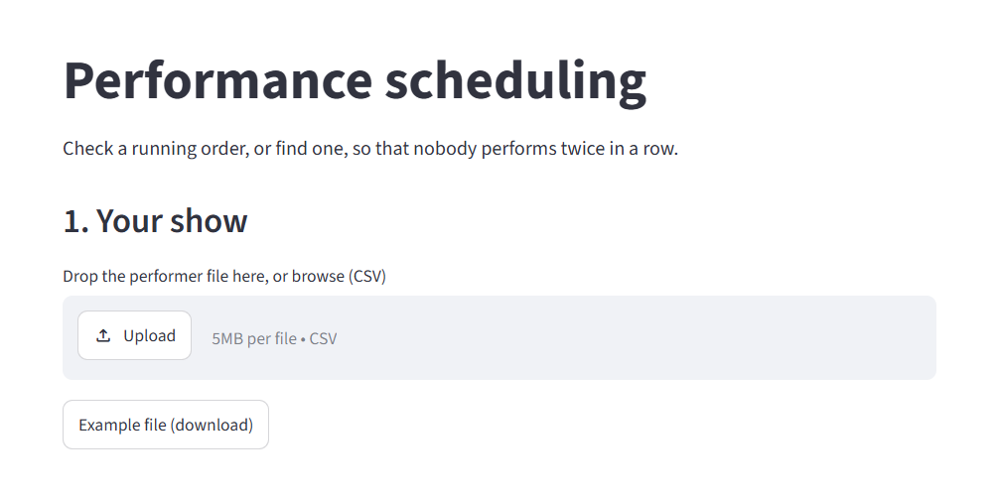
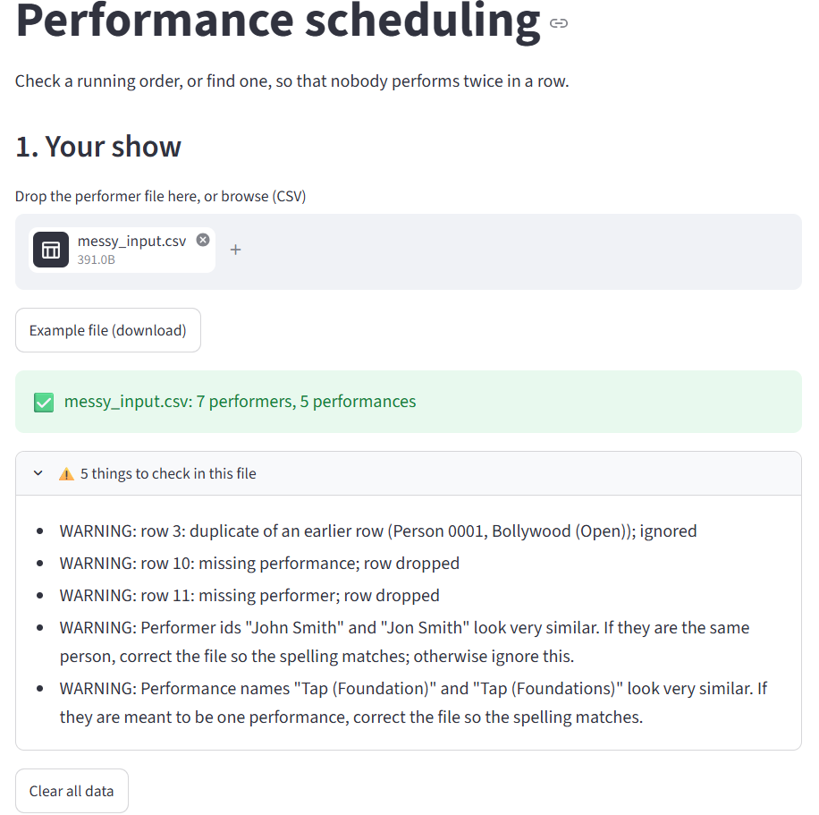
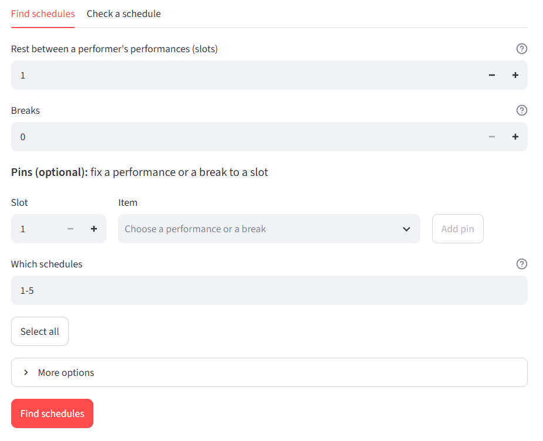
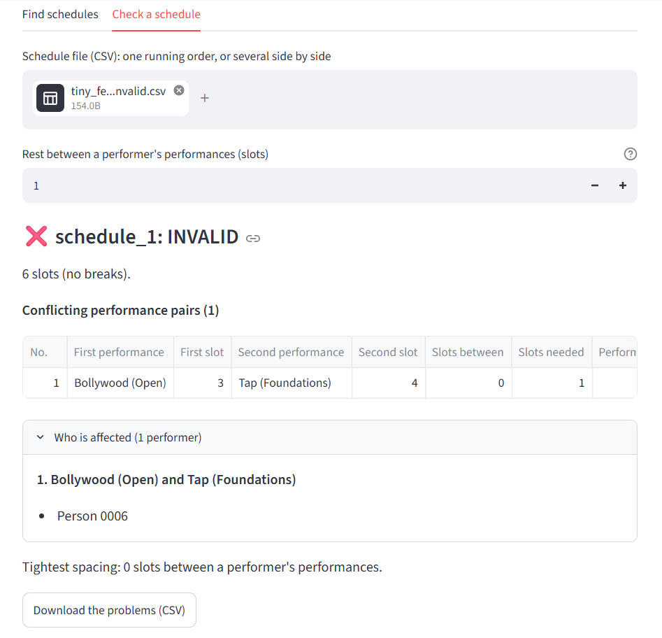

# User guide

**Status:** DRAFT (2026-10-31). For the people who organise the show. You do not need to know anything about programming. If something goes wrong, the wording of every message is explained in [error-messages.md](error-messages.md).

## What this does

A show has many performances, and many performers are in more than one performance. This page helps you choose the **running order** so that nobody has to perform again too soon. It does two jobs:

- **Find schedules:** it works out running orders for you.
- **Check a schedule:** you give it a running order you made yourself, and it tells you who would not get enough rest.

### Words used

| Word | Meaning |
|---|---|
| **Performance** | One act, for example "Bollywood (Open)". |
| **Slot** | One place in the running order. Slot 1 is first. A slot holds a performance or a break. |
| **Break** | A slot with no performance, such as an interval or a guest act from another group. Nobody is in a break, so it counts as time to rest. |
| **Rest** (also called the gap) | How many slots must be between two performances that share a performer. Rest 1 means at least one slot between them, so nobody performs twice in a row. Rest 2 means at least two, and so on. |
| **Schedule** | A complete running order. |

## 1. Prepare your performer file

The page needs one file: a list of who is in what. Make it in Excel (or Google Sheets) with **one row for each performer in each performance**, and two columns:

| full name | performance |
|---|---|
| Amy | Jazz |
| Amy | Tap |
| Ben | Jazz |
| Cat | Tap |

- The first row is a heading row. The names of the headings do not matter when there are exactly two columns.
- Use the **same spelling of a name every time** for the same person. If "Jon Smith" is typed once as "John Smith", the tool treats them as two people and will not protect either.
- A performer in only one performance needs a row too, but causes no problems.
- Do not call a performance `BREAK`. That word is reserved for breaks.
- Extra columns are allowed. The page will ask you which two to use (section 3).

### Save it as a CSV

1. In Excel choose **File, Save As**.
2. Under *Save as type* choose **CSV UTF-8 (Comma delimited)**. (In Google Sheets use **File, Download, Comma-separated values (.csv)**.)
3. Keep the file somewhere private on your computer (see [data-privacy.md](data-privacy.md)).

Choosing "CSV UTF-8" matters. It keeps accents in names correct. If you pick plain "CSV", the page will tell you to save it again.

To practise first, the page has an **Example file (download)** link under the upload box.

## 2. Start the page

1. Open the project folder and double-click **`run_app.bat`**.
2. A black window opens, then your web browser opens the page a few seconds later. If it does not, type `http://localhost:8501` into your browser's address bar.
3. **Keep the black window open** while you work. It is the page running on your computer.

The page runs only on your computer. Your file is not sent anywhere.

If the black window says the page is not set up yet, or is missing something, ask whoever set it up for you. It will say what to do.

## 3. Load your file

1. Drag your CSV into the grey box under **Drop the performer file here, or browse (CSV)**, or press **Upload** and choose the file. The file can be up to 5 MB, which is far more than a show needs.
2. If the file has more than two columns, the page asks **Which column holds the performer's name or id?** and **Which column holds the performance?** Choose both. Nothing loads until you do.
3. When the file is read you see a green line, for example *tiny_feasible.csv: 12 performers, 6 performances*. Check these numbers look right. Two tabs then appear: **Find schedules** and **Check a schedule**.

If you see a **red box** instead, the file cannot be used. It lists every problem and the row it is on (row 1 is the heading row, as in Excel). Fix them in your spreadsheet, save again, and drop the file in again. The wording of each problem is in [error-messages.md](error-messages.md), sections 1 to 3.

### Warnings: "N things to check in this file"

A box with a warning sign and the words **things to check** (it is open, so you see everything in it) means the file was read, but something needs a look. The page never changes your file. It tells you what it did, and you decide:

| What you might see | What it means | What to do |
|---|---|---|
| *missing …; row dropped* | A row had no performer or no performance and was left out. | Fill in the gap in your spreadsheet if the row matters. |
| *duplicate of an earlier row; ignored* | The same person was listed twice for the same performance. | Usually nothing. |
| *Performer ids "…" and "…" look very similar* | Possibly the same person, spelled two ways. They are being treated as two people. | If it is one person, fix the spelling in your file and load it again. **Do not skip this one.** A typo quietly removes the protection for that person. |
| *Performance names "…" and "…" look very similar* | Possibly one performance, spelled two ways. | Fix the spelling if so. |
| *Ignoring other column(s)* | Your file has more columns than the two used. | Nothing. |

After fixing the spreadsheet, load it again. A new file clears all earlier results and pins.

## 4. Find schedules

Open the **Find schedules** tab. The settings are:

| Setting | What it does | Normal value |
|---|---|---|
| **Rest between a performer's performances (slots)** | The rest described above. | 1 |
| **Breaks** | How many breaks the show has. A break counts as a slot and gives rest. | 0, or your real number of intervals and guest acts |
| **Pins (optional)** | Fix a performance, or a break, to a slot. For example "Bollywood (Open) must open the show". Pick the slot, pick the item from the list (it includes **Break**), press **Add pin**. **Remove** takes it away. (If you want a break to count as 2 slots then pin 2 next to each other) | none |
| **Which schedules** | Which of the numbered list of schedules to show. `1-5` is the first five. You can write `6-10`, `1,4,9` or `all`. | 1-5 |
| **More options** | A shuffle seed (section 4.3), the most schedules per run (100), and the longest search in seconds (30). | leave alone |

Press **Find schedules**.

### 4.1 Reading the result

You see a green line such as *Found 5 schedules (numbers 1-5).* and a table. Each **row** is a slot (1 is first), and each **column** is one schedule, named `schedule_1`, `schedule_2` and so on. A break shows as `BREAK`, and a slot you pinned is marked.

- **More schedules exist after number 5.** The list goes on. Press **Show the next 5** to see the next five. It carries on where the last list stopped, so you do not see the same schedules twice.
- **Download these schedules (CSV)** saves the table as a file you can open in Excel. It is in exactly the layout the **Check a schedule** tab reads.
- **Try a gap of 2.** Your schedules had the rest you asked for. Press this to see whether everyone could have a longer one. It is only a suggestion. Pressing it searches again with the rest one larger, so nothing changes unless you press it.
- The small grey line under the table (*Seed: default order. Search engine: OR-Tools …*) is a note. The same file and settings give the same list every time.

If you change any setting after a search, the table fades and the page says **Settings changed. Press Find schedules to update.** The table you see is from the old settings until you do.

### 4.2 When there is no schedule

A **red box** headed **No schedule exists.** means the search finished and there is no running order with your settings. It gives the reason, in words. For example:

> Person 0001 is in 3 performances; with a gap of 2 that needs at least 7 slots, but the show has 5.

That is your hint. Add breaks, lower the rest, or remove pins, then press **Find schedules** again. If pins are the cause, the box lists which ones cannot all be kept, and they are marked **These cannot all be kept** in your pin list. Remove or move one.

A **yellow box** headed **No schedule was found before the time limit** is different. The search ran out of time, so it does **not** mean none exist. Press **Search for longer**, or raise **Longest search, seconds** under *More options*.

### 4.3 The shuffle seed

Normally the list is always in the same order, so the first five are the same each time. **Shuffle** (under *More options*) picks a different starting point and shows a number in the **Shuffle seed** box. Use the same number again to get the same list, and write it down if you want to come back to a particular list.

## 5. Check a schedule

Open **Check a schedule** to test a running order you made yourself, or one that the Find tab gave you.

### 5.1 The schedule file

Make a CSV in Excel:

| position | schedule_1 |
|---|---|
| 1 | Hip Hop (Foundations) |
| 2 | Contemporary (Open) |
| 3 | Bollywood (Open) |
| 4 | Tap (Foundations) |

- The first column is called `position` and is numbered 1, 2, 3 with no gaps.
- Each other column is one running order, with a name of your choice in the heading. You can put several side by side to compare them.
- Type each performance **exactly as it is in the performer file**. Capitals do not matter.
- **An empty cell counts as a break.** The page tells you so.
- Save it as **CSV UTF-8**, as in section 1.

### 5.2 Use it

1. Drop the file into **Schedule file (CSV)**.
2. Check the **Rest between a performer's performances (slots)** is what you want. The result updates as soon as you change it.

You see, for each schedule:

- **VALID** or **INVALID**, how many slots, and how many are breaks. With several schedules you also get an **Overview** table with the result, the number of problems, and the *tightest gap* (the least rest anyone gets).
- **Conflicting performance pairs.** Each row is two performances too close together, with their slots, how many slots are between them, and how many are needed.
- **Who is affected** is a box under the table that lists the performers in each pair. Use it to decide which of the two performances to move.
- **Download the problems (CSV)** saves all of them as a file. The file contains performer names, so keep it private and delete it when you are finished.

If the schedule does not match the show (a performance missing, repeated, or spelled differently from the performer file), you get a box called **Problems with the schedule itself** instead, and the page says spacing was not checked. Fix those first. If a name is close to one in your file, the box adds *Did you mean "…"?*

With more than 10 schedules, the valid ones appear only in the Overview table, to keep the page short.

## 6. If something goes wrong

| What you see | What to do |
|---|---|
| A red box when you load a file | Fix the problems it lists (row numbers match Excel), save, and load again. |
| The page says to save as "CSV UTF-8" | Redo section 1, step 2. |
| Nothing happens after you drop a file with many columns | Choose both columns in the two lists. |
| *Performer ids … look very similar* | Fix the spelling in your file if it is one person. |
| **No schedule exists.** | Read the reason. Add breaks, lower the rest, or remove pins. |
| **No schedule was found before the time limit** | Press **Search for longer**. |
| *The schedule finder is not installed on this computer* | Ask whoever set the page up. |
| *Something unexpected went wrong …* | Close the black window, start again, and try once more. If it happens again, tell whoever set the page up what you were doing. Do not send them your real file. |
| The page will not open at all | Check the black window is still open. Close it and double-click `run_app.bat` again. |

Every message the page can show is explained in [error-messages.md](error-messages.md).

## 7. When you have finished

1. Press **Clear all data** (in the *Your show* section), which removes your file and results from the page.
2. **Close the black window.** This stops the page and removes everything from memory. Closing only the browser tab does not stop it.
3. Delete any problems file you downloaded and no longer need. Keep your performer file somewhere private. See [data-privacy.md](data-privacy.md).

## 8. Using the commands instead

The same tools can be run from a command window with `schedule-checker` and `schedule-finder`. They are for people who are comfortable with that. See [schedule-checker.md](schedule-checker.md) and [schedule-finder.md](schedule-finder.md). They give the same results and the same wording as the page.
